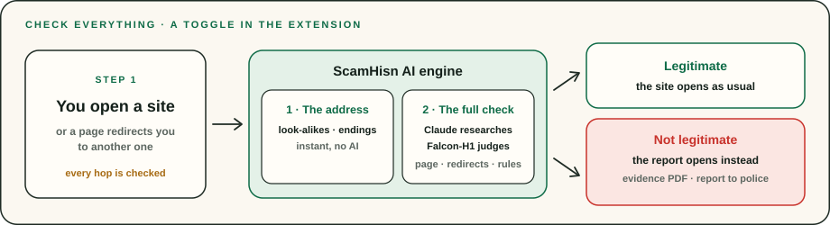

<div align="center">

<sub><strong>42 ABU DHABI × ABU DHABI POLICE — SCAMSHIELD AI HACKATHON</strong></sub>

<br /><br />


# ScamHisn AI · حصن الاحتيال

*AI-Powered Link, Image & Scam Inspector — Web App & Chrome Extension*

<br />

<a href="https://scamhisn-ai-o2k9.onrender.com/">
  
</a>

<br />

<a href="https://scamhisn-ai-o2k9.onrender.com/scamhisn-extension.zip">
  
</a>

<br />


<br /><br />

<sub>Version 2, improved after the hackathon. The version submitted for judging is kept unchanged at <a href="https://github.com/MohmedQaid/ScamHisn-AI">MohmedQaid/ScamHisn-AI</a>.</sub>

<br /><br />

**[English (EN)](#en)** &nbsp;·&nbsp; **[العربية (AR)](#ar)**

<br />


<br /><br />


</div>

<br />

<a id="en"></a>

## EN — Overview

> **Welcome, and thank you for taking the time to look at our work.** Everything here is meant to be tried, read and questioned. If you have five minutes, start with one of these.

| Start here | |
|---|---|
| **Try** | [scamhisn-ai-o2k9.onrender.com](https://scamhisn-ai-o2k9.onrender.com/): paste `https://adpolice-fines-pay.top/verify` and press **Check** |
| **Protect your browser** | Install the extension and switch on **[Check Everything](#check-everything)** |
| **Watch** | [The one-minute video](./docs/pitch/ScamHisn-AI-Pitch-Video.mp4) · [Arabic version](./docs/pitch/ScamHisn-AI-Pitch-Video-AR.mp4) |
| **Read** | [The pitch deck (PDF)](./docs/pitch/ScamHisn-AI-Pitch.pdf) |
| **Explore** | [What's in this repository](#whats-in-this-repository) |

**ScamHisn AI** is a **Web Application** and **Chrome Extension** that protects users from fraudulent links and forged screenshots—including scams impersonating **UAE PASS**, **TAMM**, **Abu Dhabi Police**, local banks, fake jobs, and hijacked **Google Maps** listings.

It works two ways:

- **Check Manually:** paste a link, a job post, a map link or a screenshot, on the website or in the extension, and get a verdict with the evidence.
- **Check Everything:** a toggle in the extension. While it is on, every site you open, and every site a page redirects you to, goes through the ScamHisn AI engine first. If a site is not legitimate, the report opens instead of the site.

> [!NOTE]
> **New in version 2:** Check Everything, a Claude and Falcon engine behind it, and Claude as a backup so the Job, Map and Screenshot checks keep working when Google's free Gemini service is busy.

> [!TIP]
> The live demo runs on free hosting. If it has been idle, the first visit takes 30 to 50 seconds to wake up; after that it is quick.

---

### What It Delivers

#### Four Inspection Modes
Check **General Links**, **Job Posts**, **Map Links**, or upload **Screenshots & Images** with a live preview to verify whether an image is genuine or forged.

<a id="check-everything"></a>

#### Check Everything
Switch it on in the extension and every site is checked before you use it, including the sites a page silently redirects you to. That is the defence against a trusted page that has been tampered with to hand visitors to a malicious one (a watering-hole attack). A bad site is replaced by the ScamHisn report, with **Download evidence report** and **Report to Abu Dhabi Police**.

#### Decisive 0–100% Scam Score
Fatal red flags immediately score **95–100%** instead of being diluted, while legitimate lookalike organizations (such as ADIB vs. DIB) are not falsely penalized.

#### Simple View + Investigator Details
Everyday users get a clear verdict at a glance; **"Show Details"** reveals technical findings for deeper investigation.

#### Forensic PDF & Police Escalation Concept
Export an investigation-ready **PDF report** in one click. The **"Report to Abu Dhabi Police"** button lists the official **Aman** channels (800 2626, SMS 2828, aman@adpolice.gov.ae); it does not submit anything for you.

---

### What It Looks Like

<table align="center">
<tr>
<td align="center" width="68%">
<strong>A scam verdict, with the evidence</strong><br /><br />

</td>
<td align="center" width="32%">
<strong>The same verdict in Arabic, on a phone</strong><br /><br />

</td>
</tr>
</table>

---

### How to Use It

<table>
<tr>
<td width="50%" valign="top">

**Web App (Phone & Laptop)**

1. Open **[scamhisn-ai-o2k9.onrender.com](https://scamhisn-ai-o2k9.onrender.com/)**.
2. Choose **Link**, **Job post**, **Map listing** or **Screenshot**, then paste a link (or the whole message) or upload an image.
3. Click **Check** to see the verdict and the evidence, or download a PDF report.

*Phone Chrome tip:* Tap menu → **Add to Home screen** to use it like an app.

</td>
<td width="50%" valign="top">

**Chrome Extension (Desktop Browsers Only)**

1. **[Download Chrome Extension (.zip)](https://scamhisn-ai-o2k9.onrender.com/scamhisn-extension.zip)** *(also linked at the very bottom of the web app)* and unzip it.
2. Open `chrome://extensions` → enable **Developer mode** → click **Load unpacked**.
3. Click the toolbar icon or right-click any link → **Inspect link with ScamHisn AI**.
4. For protection while you browse, open the **Check Everything** tab and switch it on.

</td>
</tr>
</table>

---

### How It Works

Every scan blends **Deterministic Checks** *(SSL certificates, domain age, safety guards, and isolated sandbox inspection)* with **Semantic AI Checks** *(suspicious similarities, scam red flags, visual forgery detection, and anti-prompt-injection defense)*.

#### 1. Live Website (Links & Images)

<p align="center">
  
</p>

#### 2. Chrome Extension: Check Manually

<p align="center">
  
</p>

#### 3. Chrome Extension: Check Everything

<p align="center">
  
</p>

The address is judged first, in a fraction of a second, so an obvious look-alike never loads. The full check follows: our server opens the page in a throwaway browser, follows its redirects, Claude researches it and the self-hosted Falcon-H1 makes the call. The page stays usable during those 10 to 40 seconds and is replaced by the report if the verdict is bad. Details, limits and test results are in [`Chrome Extension/README.md`](<./Chrome Extension/README.md>).

---

### Future Vision: TAMM Ecosystem Integration

Bringing **ScamHisn AI** into Abu Dhabi's **TAMM** ecosystem unlocks personalized scam protection inside the services residents already trust.

<p align="center">
  
</p>

<table align="center">
<tr>
<td align="center" width="50%">
<strong>Current TAMM Experience</strong><br /><br />

</td>
<td align="center" width="50%">
<strong>Concept: TAMM with ScamHisn AI</strong><br /><br />

</td>
</tr>
</table>

#### Personalized Fact-Checking
Cross-check scam messages against a resident's real TAMM records—instantly catching fake *"unpaid fine"* claims when their account shows *"All good, no fines."*

#### Native TAMM App Service
Embed one-tap link and screenshot verification directly inside **TAMM** with authenticated escalation to **Abu Dhabi Police**.

> [!NOTE]
> **Architecture Scope:** The exact integration design and which specific TAMM tools or services ScamHisn AI connects to are intentionally left for **TAMM experts and system architects** to design.

---

### Engineering Notes

#### Why we built it this way

| Choice | Why | Trade-off |
|---|---|---|
| **Open the link in a real headless browser** | Phishing pages hide behind redirects and scripts. Only rendering shows the real forms. | Takes seconds, not milliseconds. |
| **Rules decide first, AI second** | A clear red flag, such as a card form posting to another domain, must never be averaged away. Every point has a stated reason. | Rules need upkeep and miss lures that name no brand. |
| **Gemini Flash-Lite for manual checks** | Reads Arabic and English, reads images, and checks Google Search and Maps live. The free tier fits a prototype. | A third-party service with rate limits and outages. |
| **Claude for Check Everything, and as backup** | Check Everything runs on every site, so it must not stall when Google's free service is busy. Claude researches first there, and steps in for the other checks when every Gemini key and model fails. | Costs per call, and Claude is asked without live Google lookups. |
| **A UAE-built judge** | The self-hosted Falcon-H1 7B from TII, Abu Dhabi makes the final call in both pipelines, on our own hardware. | Depends on our machine being reachable. |
| **No single point of failure** | Gemini, then Claude, then Falcon alone, then the rules. | More moving parts to keep configured. |
| **Never "safe" on an incomplete check** | If the AI or the page is unavailable, the result reads "Incomplete check", and Check Everything shows `?`, never "cleared". | More cautious results during outages. |
| **A verdict for dead links** | Scam domains die within days. The address itself often names the brand it imitates. | An address-only verdict cannot see the page. |

#### Measured, not claimed

On a blind holdout of 141 addresses (76 real sites, 65 synthetic look-alikes), the address-analysis layer alone scored **91.5% accuracy** with **0 false alarms** on real sites and caught **53 of 65** look-alikes. The 12 misses and the limits are listed in [`docs/eval/address-layer.md`](./docs/eval/address-layer.md). Check Everything was tested in Microsoft Edge against the live site; the results are in [`Chrome Extension/README.md`](<./Chrome Extension/README.md>). The API has 149 unit tests (`npm test`).

The problem figures, cost model and savings estimate are on the in-app **Impact** page (`#/impact`) and in [`docs/IMPACT.md`](./docs/IMPACT.md). All 67 references are in [`docs/research/sources.md`](./docs/research/sources.md); the UAE open-data files we used are in [`data/open-data/`](./data/open-data/). The pitch deck and the one-minute pitch video are in [`docs/pitch/`](./docs/pitch/).

#### Privacy

- No accounts, no database, no analytics. Nothing you scan is written to disk.
- Links, page excerpts and screenshots are sent to Google's Gemini API, or to Anthropic's Claude API, for analysis. Screenshots are shrunk in your browser first.
- While Check Everything is on, the address of every site you open is sent to the ScamHisn server. Nothing is sent while it is off.
- Image results, not the images, are cached in memory for 30 minutes by SHA-256 fingerprint.
- Each page opens in a throwaway browser context that is discarded after the scan.
- Server logs record errors only.

#### What we left out

- Watching newly registered domains on our own, before anyone opens or sends them.
- A police-side dashboard that groups reports into campaigns.
- Direct submission to the police. The report button lists the official Aman channels; the user sends the report.
- The TAMM claim-check. It is a concept and needs a government integration.
- On-device text reading for screenshots, so screenshots currently leave the device.
- Public threat feeds, user accounts, and Chrome Web Store publication.

#### What we would do differently with more time

- Judge private content (messages, screenshots) on a self-hosted model first, and send only public names to a cloud AI for lookups.
- Build a labelled Arabic and Emirati-dialect scam corpus and measure the full pipeline, not one layer.
- Fine-tune a small Arabic model on that corpus.
- Sign the PDF reports so they cannot be forged.
- Run Chromium as a non-root user with its own sandbox enabled.

#### Run it locally

```bash
cd "Deployable Website Application"
npm install
npm run install:browser      # headless Chromium for the scanner
cp .env.example .env         # then set GEMINI_API_KEY, and ANTHROPIC_API_KEY for Claude
npm run dev                  # web on :5173, API on :3001
npm test                     # 149 API unit tests
```

The AI pipeline (hybrid mode, fallbacks, cool-down, running the local model) is configured with environment variables; see [`docs/AI_FALLBACK_SETUP.md`](./docs/AI_FALLBACK_SETUP.md).

---

### Hosting & Deployment (Not Required — Already Live!)

**You do not need to host or deploy anything yourself** — the live app is already running at **[scamhisn-ai-o2k9.onrender.com](https://scamhisn-ai-o2k9.onrender.com/)**.

If you ever want to deploy your own free copy on **Render**:

1. On Render choose **New → Blueprint** (or a Docker Web Service) and connect this repository. The `render.yaml` and `Dockerfile` at the repository root are all it needs; no root directory setting.
2. Add `GEMINI_API_KEY`, and `ANTHROPIC_API_KEY` for Check Everything and the Claude backup (see `.env.example`), in Render's Environment Variables and deploy.
3. Open `/api/v1/health` on the new address: `"status": "ok"` with a `capabilities` block means the current version is running.
4. If your address is not `scamhisn-ai-o2k9.onrender.com`, change `DEFAULT_API_BASE` in `Chrome Extension/scripts/build.mjs` and run it, so the extension talks to your copy.

The full guide, including what to check when the live site does not update, is in [`docs/DEPLOYMENT.md`](./docs/DEPLOYMENT.md).

---

### What's in this repository

| Where | What you will find |
|---|---|
| [`Deployable Website Application/`](<./Deployable Website Application/>) | The product: the bilingual website and the API behind it, with 149 automated tests. |
| [`Chrome Extension/`](<./Chrome Extension/>) | The browser extension with Check Manually and Check Everything, ready to load, and its source. |
| [`docs/`](./docs/) | The evidence behind this page: measured accuracy, the AI setup, impact and cost, research with 67 sources, and how to deploy. |
| [`docs/pitch/`](./docs/pitch/) | The pitch deck and the one-minute video, in English and Arabic. |
| [`data/open-data/`](./data/open-data/) | The UAE government open-data files our figures draw on. |
| [`assets/`](./assets/) | The images used on this page. |
| `Dockerfile`, `render.yaml` | One-step deployment of the whole app. |

Each folder opens with a short guide of its own.

---

### Team Cybersound

`Mohammed Ahmed Abdulnoor` · `Abdulrhman Ahmed Drizi` · `Khalid Ahmed Al Khawaldah` · `Ahmed Al Hashmi` · `Yousef Mohammed`

<br />

<div align="center">
  
</div>

<br />

<a id="ar"></a>

<div dir="rtl">

## AR — نظرة عامة

> **أهلاً بك، وشكراً لوقتك في الاطلاع على عملنا.** كل ما هنا متاح للتجربة والقراءة والنقاش. إن كان لديك خمس دقائق فابدأ بأحد هذه الخيارات.

| ابدأ من هنا | |
|---|---|
| **جرّب** | [scamhisn-ai-o2k9.onrender.com](https://scamhisn-ai-o2k9.onrender.com/): الصق `https://adpolice-fines-pay.top/verify` واضغط **افحص** |
| **احمِ متصفحك** | ثبّت الإضافة وفعّل خاصية **[افحص كل شيء](#افحص-كل-شيء)** |
| **شاهد** | [الفيديو في دقيقة واحدة](./docs/pitch/ScamHisn-AI-Pitch-Video-AR.mp4) · [النسخة الإنجليزية](./docs/pitch/ScamHisn-AI-Pitch-Video.mp4) |
| **اقرأ** | [عرض التقديم (PDF)](./docs/pitch/ScamHisn-AI-Pitch.pdf) |
| **تصفّح** | [محتويات المستودع](#محتويات-المستودع) |

**حصن الاحتيال (ScamHisn AI)** هو **تطبيق ويب** و**إضافة لمتصفح كروم** لحماية المستخدمين من الروابط الاحتيالية والصور المزوّرة، بما في ذلك عمليات الانتحال التي تستهدف **الهوية الرقمية (UAE PASS)** و**منظومة تم (TAMM)** و**شرطة أبوظبي** والبنوك المحلية وإعلانات التوظيف الوهمية و**خرائط جوجل**.

يعمل بطريقتين:

- **الفحص اليدوي:** الصق رابطاً أو إعلان وظيفة أو رابط خريطة أو لقطة شاشة، في الموقع أو في الإضافة، لتحصل على الحكم مع الأدلة.
- **افحص كل شيء:** زر تفعيل في الإضافة. ما دام مفعّلاً، يمر كل موقع تفتحه، وكل موقع تُحوَّل إليه، على محرك حصن الاحتيال أولاً. إذا لم يكن الموقع سليماً يُفتح التقرير بدلاً منه.

> **الجديد في النسخة الثانية:** خاصية «افحص كل شيء»، ومحرك Claude وFalcon خلفها، وClaude كبديل احتياطي حتى تستمر فحوصات الوظائف والخرائط ولقطات الشاشة عندما تكون خدمة Gemini المجانية من جوجل مشغولة.

> النسخة المباشرة تعمل على استضافة مجانية؛ إذا كانت خاملة فقد تستغرق الزيارة الأولى 30–50 ثانية، ثم تصبح سريعة.

---

### أبرز ما يقدمه التطبيق

#### أربعة أوضاع للفحص
افحص **الروابط العامة** أو **إعلانات الوظائف** أو **روابط الخرائط** أو ارفع **الصور ولقطات الشاشة** مع معاينة فورية للتحقق من أصالتها وكشف التزوير.

<a id="افحص-كل-شيء"></a>

#### افحص كل شيء
فعّلها في الإضافة، فيُفحص كل موقع قبل أن تستخدمه، بما في ذلك المواقع التي تحوّلك إليها صفحة ما دون أن تنتبه. هذا هو خط الدفاع ضد صفحة موثوقة تم التلاعب بها لتسليم زوارها إلى موقع خبيث (هجوم «حفرة الماء»). ويُستبدل الموقع غير السليم بتقرير حصن الاحتيال مع زرّي **تحميل تقرير الأدلة** و**بلّغ شرطة أبوظبي**.

#### نسبة احتمال احتيال حاسمة (0–100%)
تصل النتيجة فوراً إلى **95–100%** عند وجود أدلة قاطعة دون تمييع، مع تجنّب الإنذارات الكاذبة للجهات الشرعية متشابهة الأسماء (مثل ADIB وDIB).

#### عرض بسيط وتفاصيل للمحققين
يظهر ملخص واضح وسريع للمستخدم العادي، مع زر **«عرض التفاصيل التقنية»** لعرض الأدلة المعمّقة عند الحاجة.

#### تقرير PDF ومفهوم الإبلاغ للشرطة
إمكانية تصدير **تقرير أدلة بصيغة PDF** بضغطة زر. وزر **«بلّغ شرطة أبوظبي»** يعرض قنوات خدمة **«أمان»** الرسمية (8002626، رسالة نصية 2828، aman@adpolice.gov.ae) ولا يرسل شيئاً بالنيابة عنك.

---

### شكل التطبيق

<table align="center">
<tr>
<td align="center" width="68%">
<strong>نتيجة فحص رابط احتيالي مع الأدلة</strong><br /><br />

</td>
<td align="center" width="32%">
<strong>النتيجة نفسها بالعربية على الهاتف</strong><br /><br />

</td>
</tr>
</table>

---

### طريقة الاستخدام

<table>
<tr>
<td width="50%" valign="top">

**تطبيق الويب (الهاتف والحاسوب)**

1. افتح **[scamhisn-ai-o2k9.onrender.com](https://scamhisn-ai-o2k9.onrender.com/)**.
2. اختر **رابط** أو **إعلان وظيفة** أو **رابط خريطة** أو **لقطة شاشة**، ثم الصق الرابط (أو الرسالة كاملة) أو ارفع الصورة.
3. اضغط **افحص** لعرض النتيجة أو التفاصيل أو تحميل تقرير PDF.

*لمستخدمي كروم على الهاتف:* من القائمة اختر **إضافة إلى الشاشة الرئيسية** لاستخدامه كتطبيق.

</td>
<td width="50%" valign="top">

**إضافة كروم (لمتصفحات الحاسوب فقط)**

1. **[تحميل إضافة كروم (.zip)](https://scamhisn-ai-o2k9.onrender.com/scamhisn-extension.zip)** *(كما يتوفر رابط التحميل في نهاية صفحة تطبيق الويب)* ثم فك الضغط عن الملف.
2. افتح `chrome://extensions` ← فعّل **وضع مطوّر البرامج** ← اضغط **Load unpacked** واختر المجلد.
3. اضغط أيقونة الإضافة أو انقر بزر الفأرة الأيمن على أي رابط لفحصه فوراً.
4. لحماية مستمرة أثناء التصفح، افتح تبويب **افحص كل شيء** وفعّله.

</td>
</tr>
</table>

---

### آلية العمل

يجمع كل فحص بين **الفحوصات الحتمية** *(شهادات SSL، عمر النطاق، ضوابط الأمان، والبيئة المعزولة)* وبين **الفحص الدلالي بالذكاء الاصطناعي** *(التشابه المشبوه، علامات الاحتيال، كشف تزوير الصور، وصد حقن الأوامر)*.

#### 1. تطبيق الويب المباشر (الروابط والصور)

<p align="center">
  
</p>

#### 2. إضافة كروم: الفحص اليدوي

<p align="center">
  
</p>

#### 3. إضافة كروم: افحص كل شيء

<p align="center">
  
</p>

يُحكم على العنوان أولاً خلال جزء من الثانية، فلا يُفتح العنوان المقلّد الواضح أصلاً. ثم يأتي الفحص الكامل: يفتح خادمنا الصفحة في متصفح مؤقت، ويتتبع تحويلاتها، ويبحث Claude فيها، ويُصدر نموذج Falcon-H1 المستضاف ذاتياً الحكم. تبقى الصفحة قابلة للاستخدام خلال هذه الثواني (10 إلى 40 ثانية)، وتُستبدل بالتقرير إذا جاءت النتيجة سيئة. التفاصيل والحدود ونتائج الاختبار في [`Chrome Extension/README.md`](<./Chrome Extension/README.md>).

---

### الرؤية المستقبلية: التكامل مع منظومة «تم» (TAMM)

يتيح دمج **حصن الاحتيال** ضمن **منظومة «تم» (TAMM)** حماية استباقية مخصّصة للمستخدم داخل الخدمات الحكومية التي يثق بها يومياً.

<p align="center">
  
</p>

<table align="center">
<tr>
<td align="center" width="50%">
<strong>تطبيق «تم» الحالي</strong><br /><br />

</td>
<td align="center" width="50%">
<strong>تصوّر مستقبلي: «تم» مع حصن الاحتيال</strong><br /><br />

</td>
</tr>
</table>

#### كشف مخصّص للاحتيال عبر بيانات المستخدم
التحقق الفوري من ادعاءات الرسائل المشبوهة (مثل *"مخالفة مرورية غير مدفوعة"*) مقارنةً بحالة المستفيد الفعلية في «تم» (مثل ظهور *"لا توجد مخالفات"*).

#### خدمة مدمجة داخل تطبيق «تم»
توفير فحص الروابط والصور بضغطة واحدة داخل التطبيق مع إمكانية رفع البلاغات الموثّقة مباشرةً إلى **شرطة أبوظبي**.

> **نطاق التصميم المعماري:**
>
> تُترك تفاصيل آلية التكامل التقني والأدوات أو الخدمات المحددة التي يتصل بها «حصن الاحتيال» داخل منظومة «تم» **للخبراء ومهندسي الأنظمة المختصين** لتصميمها وفق أعلى معايير الأمان والخصوصية.

---

### ملاحظات هندسية

#### لماذا بنيناه بهذه الطريقة

| الاختيار | السبب | المقابل |
|---|---|---|
| **فتح الرابط في متصفح حقيقي معزول** | صفحات التصيّد تختبئ خلف التحويلات والسكربتات، ولا تظهر نماذجها الحقيقية إلا عند فتحها. | يستغرق ثواني لا أجزاء من الثانية. |
| **القواعد أولاً ثم الذكاء الاصطناعي** | الدليل القاطع، مثل نموذج بطاقة يرسل البيانات لنطاق آخر، لا يجوز أن يذوب في المتوسطات. ولكل نقطة سبب معلن. | القواعد تحتاج صيانة ولا تلتقط الطُعم الذي لا يذكر اسم جهة. |
| **Gemini Flash-Lite للفحص اليدوي** | يقرأ العربية والإنجليزية والصور، ويتحقق مباشرةً من بحث وخرائط جوجل، والباقة المجانية تكفي لنموذج أولي. | خدمة خارجية لها حدود استخدام وانقطاعات. |
| **Claude لخاصية «افحص كل شيء» وكبديل احتياطي** | «افحص كل شيء» تعمل على كل موقع، فلا يجوز أن تتوقف حين تكون خدمة جوجل المجانية مشغولة. يبحث Claude أولاً هناك، ويتولى الفحوصات الأخرى إذا فشلت كل مفاتيح ونماذج Gemini. | تكلفة على كل طلب، ولا يجري Claude بحثاً مباشراً في جوجل. |
| **حَكَم مطوَّر في الإمارات** | نموذج Falcon-H1 7B من معهد TII في أبوظبي، مستضاف على أجهزتنا، يُصدر الحكم النهائي في المسارين. | يعتمد على إمكانية الوصول إلى جهازنا. |
| **بلا نقطة فشل واحدة** | Gemini، ثم Claude، ثم Falcon وحده، ثم القواعد. | أجزاء أكثر تحتاج إلى إعداد. |
| **لا نقول «آمن» في فحص غير مكتمل** | إذا تعذّر الذكاء الاصطناعي أو فتح الصفحة تظهر النتيجة «فحص غير مكتمل»، وتعرض «افحص كل شيء» علامة `?` لا «سليم». | نتائج أكثر تحفظاً وقت الانقطاع. |
| **حُكم على الروابط المتوقفة** | نطاقات الاحتيال تختفي خلال أيام، والعنوان نفسه كثيراً ما يكشف الجهة المنتحَلة. | الحكم من العنوان فقط لا يرى الصفحة. |

#### قياس لا ادّعاء

على مجموعة اختبار محجوبة من 141 عنواناً (76 موقعاً حقيقياً و65 عنواناً مقلّداً مصطنعاً) حققت طبقة تحليل العنوان وحدها **دقة 91.5%** مع **صفر إنذارات كاذبة** على المواقع الحقيقية، وكشفت **53 من 65** عنواناً مقلّداً. الحالات الـ12 التي لم تُكشف وحدود القياس موثّقة في [`docs/eval/address-layer.md`](./docs/eval/address-layer.md). اختُبرت خاصية «افحص كل شيء» في متصفح Edge على الموقع المباشر، والنتائج في [`Chrome Extension/README.md`](<./Chrome Extension/README.md>). وللواجهة البرمجية 149 اختباراً آلياً (`npm test`).

أرقام المشكلة ونموذج التكلفة وتقدير التوفير معروضة في صفحة **الأثر** داخل التطبيق (`#/impact`) وفي [`docs/IMPACT.md`](./docs/IMPACT.md). المراجع الـ67 كلها في [`docs/research/sources.md`](./docs/research/sources.md)، وملفات البيانات المفتوحة الإماراتية المستخدمة في [`data/open-data/`](./data/open-data/). عرض التقديم وفيديو العرض (دقيقة واحدة) في [`docs/pitch/`](./docs/pitch/).

#### الخصوصية

- لا حسابات ولا قاعدة بيانات ولا تتبّع، ولا يُحفظ أي شيء تفحصه على القرص.
- تُرسل الروابط ومقتطفات الصفحات ولقطات الشاشة إلى واجهة Gemini من جوجل أو واجهة Claude من Anthropic للتحليل، وتُصغَّر اللقطات داخل متصفحك أولاً.
- ما دامت خاصية «افحص كل شيء» مفعّلة، يُرسل عنوان كل موقع تفتحه إلى خادم حصن الاحتيال. ولا يُرسل شيء وهي متوقفة.
- تُحفظ نتائج فحص الصور، لا الصور نفسها، في الذاكرة 30 دقيقة ببصمة SHA-256.
- تُفتح كل صفحة في جلسة متصفح مؤقتة تُحذف بعد الفحص.
- سجلات الخادم تدوّن الأخطاء فقط.

#### ما لم ننفّذه

- مراقبة النطاقات المسجّلة حديثاً بأنفسنا، قبل أن يفتحها أحد أو يرسلها.
- لوحة للشرطة تجمع البلاغات في حملات.
- إرسال البلاغ مباشرةً للشرطة؛ فزر الإبلاغ يعرض قنوات «أمان» الرسمية والمستخدم هو من يرسل.
- التحقق من الادعاء عبر «تم»؛ وهو تصوّر يحتاج تكاملاً حكومياً.
- قراءة نص اللقطات على الجهاز نفسه، ولذلك تغادر اللقطات الجهاز حالياً.
- قوائم التهديدات العامة، وحسابات المستخدمين، والنشر في متجر كروم.

#### ما كنا سنغيّره لو توفر وقت أكثر

- تحليل المحتوى الخاص (الرسائل واللقطات) على نموذج مستضاف ذاتياً أولاً، وإرسال الأسماء العامة فقط إلى خدمة ذكاء اصطناعي سحابية للتحقق.
- بناء مجموعة بيانات عربية وإماراتية مصنّفة لرسائل الاحتيال، وقياس المنظومة كاملة لا طبقة واحدة.
- تدريب نموذج عربي صغير على تلك المجموعة.
- توقيع تقارير PDF رقمياً حتى لا تُزوَّر.
- تشغيل Chromium بمستخدم محدود الصلاحيات مع تفعيل عزله الداخلي.

#### التشغيل محلياً

<div dir="ltr">

```bash
cd "Deployable Website Application"
npm install
npm run install:browser      # headless Chromium for the scanner
cp .env.example .env         # then set GEMINI_API_KEY, and ANTHROPIC_API_KEY for Claude
npm run dev                  # web on :5173, API on :3001
npm test                     # 149 API unit tests
```

</div>

إعداد سلسلة البدائل يتم بمتغيرات البيئة؛ انظر [`docs/AI_FALLBACK_SETUP.md`](./docs/AI_FALLBACK_SETUP.md).

---

### الاستضافة والنشر (غير مطلوب — التطبيق منشور وجاهز!)

**لا حاجة لاستضافة التطبيق أو نشره بنفسك**؛ فالنسخة المباشرة جاهزة للاستخدام الفوري عبر **[scamhisn-ai-o2k9.onrender.com](https://scamhisn-ai-o2k9.onrender.com/)**.

ومع ذلك، إذا رغبت في نشر نسختك الخاصة مجاناً على **Render**:

1. في Render اختر **New ← Blueprint** (أو Docker Web Service) واربطه بهذا المستودع. يكفي ملفا `render.yaml` و`Dockerfile` الموجودان في جذر المستودع، ولا حاجة لتحديد مجلد جذر.
2. أضف `GEMINI_API_KEY`، و`ANTHROPIC_API_KEY` لخاصية «افحص كل شيء» والبديل الاحتياطي (انظر `.env.example`)، في متغيرات البيئة ثم ابدأ النشر.
3. افتح `/api/v1/health` على العنوان الجديد: ظهور `"status": "ok"` مع قسم `capabilities` يعني أن النسخة الحالية تعمل.
4. إذا لم يكن عنوانك `scamhisn-ai-o2k9.onrender.com`، غيّر `DEFAULT_API_BASE` في `Chrome Extension/scripts/build.mjs` ثم شغّله، لتتصل الإضافة بنسختك.

الدليل الكامل، ومنه ما يجب فحصه إذا لم يتحدّث الموقع المباشر، في [`docs/DEPLOYMENT.md`](./docs/DEPLOYMENT.md).

---

### محتويات المستودع

| المكان | ما ستجده |
|---|---|
| [`Deployable Website Application/`](<./Deployable Website Application/>) | المنتج نفسه: الموقع بالعربية والإنجليزية والواجهة البرمجية خلفه، مع 149 اختباراً آلياً. |
| [`Chrome Extension/`](<./Chrome Extension/>) | إضافة المتصفح بوضعَي الفحص اليدوي و«افحص كل شيء»، جاهزة للتحميل مع شيفرتها المصدرية. |
| [`docs/`](./docs/) | الأدلة وراء هذه الصفحة: الدقة المقيسة، إعداد نماذج الذكاء الاصطناعي، الأثر والتكلفة، البحث مع 67 مرجعاً، وطريقة النشر. |
| [`docs/pitch/`](./docs/pitch/) | عرض التقديم والفيديو في دقيقة واحدة، بالعربية والإنجليزية. |
| [`data/open-data/`](./data/open-data/) | ملفات البيانات المفتوحة الحكومية الإماراتية التي تستند إليها أرقامنا. |
| [`assets/`](./assets/) | الصور المستخدمة في هذه الصفحة. |
| `Dockerfile` و `render.yaml` | نشر التطبيق كاملاً بخطوة واحدة. |

في بداية كل مجلد دليل قصير خاص به.

---

### فريق العمل — Team Cybersound

`Mohammed Ahmed Abdulnoor` · `Abdulrhman Ahmed Drizi` · `Khalid Ahmed Al Khawaldah` · `Ahmed Al Hashmi` · `Yousef Mohammed`

</div>
